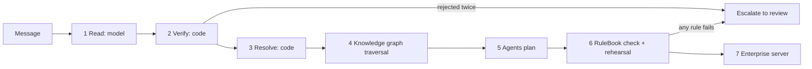

# Ripple Radar: technical documentation

This document explains what Ripple Radar does from the moment a message arrives to the moment the enterprise server accepts the last action. It focuses on the two things that decide whether the system can be trusted:

1. **The knowledge graph.** Every affected record is found by walking the graph, and every action carries the graph path that justifies it.
2. **Keeping the language model from hallucinating.** The model only reads the message. Every value it returns is checked against the message and the company data, and no identifier the model writes is ever sent to the server.

Every number in this document comes from the code, the data, or the official run (`submission/action_log.jsonl`).

---

## 1. What Ripple Radar does

Wacky Wheels Co. builds cars just in time, with no parts inventory. When a shipment is late, a plant goes down or a part lot is defective, the effect ripples into production schedules, dealers, loaner cars and owners. Ripple Radar handles each incoming message in seven steps:

| # | Step | Done by | Output |
|---|---|---|---|
| 1 | Read | Language model (Qwen2.5 3B, local) | Incidents as JSON, with values copied from the message |
| 2 | Verify the reading | Code (`extract.py`) | Every value grounded in the message and resolved to a real record, or rejected |
| 3 | Resolve | Code (`tower/world.py`) | Real ids (`P_AL`, `CAM-360`, `SH-0256`) and real dates |
| 4 | Trace impact | Knowledge graph (`tower/graph.py`) | Affected production orders, customer orders, dealers, customers, vehicles, each with its graph path |
| 5 | Plan | Four agents (`tower/agents.py`) | Tool calls: reschedule, transfer, notify, loaner, stop sale, hold lot, escalate |
| 6 | Check | RuleBook (`tower/rules.py`) | All 10 handbook rules recomputed from the raw tables, plus a rehearsal on a private copy of the enterprise |
| 7 | Execute and record | `run.py` | Calls to the enterprise server; a trace per event; graph and ontology exports |



The design rule is simple: the model reads, and code decides. The model's only job is turning messy wording into fields. It never chooses an order, a date, a slot, a dealer, a loaner or a vehicle. Those all come from graph traversal and deterministic planning over the company data.

---

## 2. Worked example: E-09, end to end

The real message, received 09:33 by supplier email:

> Quick heads up from Orbit: the surround-view cameras run for Huntsville can't make it Monday Mar 29. Carrier says Thursday Apr 1 now (a customs inspection).

**Step 1, read.** The model returned:

```json
{"kind": "supplier_delay", "supplier": "Carrier", "part": "surround-view cameras", "plant": "Huntsville",
 "original_eta": "Monday Mar 29", "new_eta": "Thursday Apr 1",
 "evidence": "Carrier says Thursday Apr 1 now (a customs inspection)."}
```

The model made a mistake here: "Carrier" is the trucking company, not the supplier.

**Step 2, verify.** Every field appears in the message word for word, so grounding passes. The kind matches the wording ("can't make it", "now"). The supplier is optional and "Carrier" matches no supplier, so code records the warning `supplier ignored: cannot resolve supplier 'Carrier'` and moves on. The model's mistake has no effect, because the supplier is never taken from the model (step 3).

**Step 3, resolve.**

| Mention | Resolved to | How |
|---|---|---|
| "Huntsville" | `P_AL` | `aliases.csv` |
| "surround-view cameras" | `CAM-360` | `aliases.csv` |
| "Monday Mar 29" | 2027-03-29 | Date resolver; the weekday matches the date |
| "Thursday Apr 1" | 2027-04-01 | Date resolver; the weekday matches the date |
| (shipment) | `SH-0256`, supplier `SUP-11` Orbit Optics | The only inbound shipment of `CAM-360` to `P_AL` with ETA 2027-03-29 |

The disruption is: `CAM-360` missing at `P_AL` from 2027-03-29 up to, but not including, 2027-04-01.

**Step 4, trace.** The graph walks from the shipment:

`Shipment:SH-0256` carries `Part:CAM-360`, which is contained in `Model:SUMMIT` and `Model:VOYAGER`. Both are built at `Plant:P_AL`. The production orders scheduled at `P_AL` in the gap, of those models, are `PO-0436`, `PO-0438`, `PO-0439`, `PO-0441`, `PO-0442` and `PO-0444`. From each order the graph continues to its customer orders, each customer order's dealer, and each customer's tier.

**Step 5, plan.**
- The Supply Chain Planner moves each build to the earliest free slot on or after Apr 1. Huntsville takes four (two on Apr 1, two on Apr 2) and is then full. `PO-0442` and `PO-0444` transfer to San Antonio and Lexington on Apr 1.
- Dealer and Customer Care sends 26 dealer notices and assigns 10 loaners. Two Gold customers at dealer D25 get none, because the dealer has one loaner and they rank 2nd and 3rd.

**Step 6, check.** Rules 1, 3, 4, 5, 9 and 10 apply, and all pass. The rehearsal on a private enterprise copy accepts all 42 calls.

**Step 7, execute.** 42 calls are sent and 42 accepted. `traces/E-09.json` records every call with its graph path, for example:

`Shipment:SH-0256, Part:CAM-360, Model:SUMMIT, ProductionOrder:PO-0436, CustomerOrder:CO-02572, Dealer:D02`

For each moved build it also records the options rejected. For `PO-0442`: Huntsville is full Apr 1 to Apr 2; Lexington is also free Apr 1 but comes second in the plant list; Jackson, Princeton and Greensboro don't build the Summit; San Antonio Apr 1 is chosen.

---

## 3. The knowledge graph

### 3.1 What it is

A NetworkX `MultiDiGraph` built in `tower/graph.py` from the company tables at startup. After the official run it holds 17,772 nodes and 31,559 edges. Every node id is `Type:key` (for example `ProductionOrder:PO-0442`), so a graph node and a data record always share the same key.

### 3.2 Node types (14)

| Type | Count | Built from | Attributes kept |
|---|---|---|---|
| Plant | 6 | `plants.csv` | label, slots per day (5) |
| Model | 6 | `models.csv` | label |
| Part | 20 | `parts.csv` | name |
| Supplier | 18 | `suppliers.csv` | name |
| Shipment | 364 | `inbound_shipments.csv` | ETA |
| Lot | 364 | `part_lots.csv` | first and last build date |
| ProductionOrder | 540 | `production_orders.csv` | model, build date, day index |
| CustomerOrder | 3,263 | `customer_orders.csv` | promised date |
| Customer | 7,000 | `customers.csv` | name, tier |
| Dealer | 50 | `dealers.csv`, `loaners.csv` | name and city, loaner pool |
| Vehicle | 5,348 | `finished_vehicles.csv` | model, build date, status |
| Rule | 10 | `policy_handbook.md` | label |
| Event | 15 | each message handled | text, classification |
| Action | 768 | each planned tool call | tool, agent, reason, graph path |

The first eleven types are the company. The last three are the decision layer: what happened (Event), what was done (Action), and under which rule (Rule).

### 3.3 Relations (27)

| From | Relation | To | Count | Meaning |
|---|---|---|---|---|
| Plant | builds | Model | 18 | from `plant_models.csv` |
| Model | contains | Part | 47 | bill of materials, `bom.csv` |
| Supplier | ships | Shipment | 364 | |
| Shipment | carries | Part | 364 | |
| Shipment | delivers_to | Plant | 364 | |
| Supplier | made | Lot | 364 | |
| Lot | batch_of | Part | 364 | |
| Lot | used_at | Plant | 364 | |
| Lot | installed_in | ProductionOrder | 1,410 | derived: same plant, model uses the part, build date inside the lot's window |
| ProductionOrder | scheduled_at | Plant | 540 | |
| ProductionOrder | of_model | Model | 540 | |
| ProductionOrder | promised_to | CustomerOrder | 3,263 | |
| ProductionOrder | produced | Vehicle | 5,348 | |
| CustomerOrder | placed_at | Dealer | 3,263 | |
| CustomerOrder | for | Customer | 3,263 | |
| Vehicle | stocked_at | Dealer | 2,421 | unsold (`in_stock`) |
| Vehicle | sold_by | Dealer | 2,927 | sold |
| Vehicle | owned_by | Customer | 2,927 | |
| Action | triggered_by | Event | 768 | |
| Action | applies | Rule | 768 | |
| Action | acts_on | ProductionOrder | 50 | |
| Action | acts_on | CustomerOrder | 548 | |
| Action | acts_on | Dealer | 290 | |
| Action | acts_on | Customer | 423 | |
| Action | acts_on | Vehicle | 556 | |
| Action | acts_on | Lot | 3 | |
| Action | acts_on | Event | 2 | escalations |

`installed_in` is the one relation the data does not state directly. The graph derives it once, at build time, from three facts that are in the data: the lot's plant, the bill of materials, and the lot's build window. This is what lets a quality hold reach the exact vehicles.

The schema is exported as `submission/ontology/ontology.json` and as a Mermaid diagram, `ontology.mmd`. Two pictures are drawn from it: `ontology_overview.png` (the main relationships and the two traced paths, for a quick read) and `ontology.png` (every relation type with counts). The full graph is exported as `submission/ontology/graph.json` (node-link JSON).

### 3.4 How the graph is used: four traversals

All impact is found by walking edges. Each traversal returns the records and the path that reached them.

| Traversal | Used for | Walk |
|---|---|---|
| `delay_impact` | Supplier delay | Shipment `carries` Part; Shipment `delivers_to` Plant; Models that `contains` the part and that the plant `builds`; ProductionOrders `scheduled_at` the plant, `of_model` one of them, with build day in the gap |
| `outage_impact` | Plant outage | ProductionOrders `scheduled_at` the plant with build day in the outage |
| `orders_downstream` | Every moved build | ProductionOrder `promised_to` CustomerOrder, `placed_at` Dealer, `for` Customer |
| `lot_impact` | Quality hold | Lot `installed_in` ProductionOrder `produced` Vehicle; then `stocked_at` Dealer (unsold) or `sold_by` Dealer and `owned_by` Customer (sold) |

`one(node, relation)` insists on exactly one edge where the data model says there must be one, for example a shipment carries one part. If the graph ever disagreed with that, the traversal would raise an error instead of guessing.

### 3.5 Provenance: every action is part of the graph

Each planned call becomes an `Action` node, linked `triggered_by` its Event, `applies` its Rule, and `acts_on` every record it touches. Its `path` attribute is the traversal that justified it. So for any record, the graph can answer "what was done to this, by which agent, under which rule, and why". The app's **Supply network** page does exactly that through `why(node)`.

Example, from the record page for `ProductionOrder:PO-0442`: Builds transferred, E-09, Supply Chain Planner, rule 3, "SUMMIT order built 2027-03-31 at P_AL moves to P_TX 2027-04-01: P_AL has no free slot 2027-04-01 to 2027-04-02".

### 3.6 Graph evidence and fact check, per incident

Before planning, `fact_check` confirms the relationships implied by the resolved reading as actual edges in the graph. It is a consistency check on resolved records: it catches a reading that resolves to real records that do not belong together. For a delay: the shipment `carries` the part, `delivers_to` the plant, its supplier `ships` it, and the plant `builds` each affected model, which `contains` the part. For a quality hold: the lot is a `batch_of` the part, was `used_at` the plant, and its supplier `made` it. If any claim is not an edge, nothing is planned and the event is escalated with the failed claim. On the 15 official events, 37 of 37 claims are confirmed.

After planning, `evidence` writes the path the challenge asks for into each incident's trace, with an example path and counts at every hop:

| Incident | Required path | E-01 example |
|---|---|---|
| Supplier delay | Shipment > Part > Model (BOM) > ProductionOrder > CustomerOrder > Dealer / Customer | SH-0190 > CHIP-IVI > VOYAGER > PO-0316 > CO-01756 > D07 / C4130 (8 builds, 67 orders, 29 dealers) |
| Plant outage | Plant > ProductionOrder > CustomerOrder > Dealer / Customer | P_TX > PO-0058 > CO-00247 > D18 / C6387 (6 builds, 55 orders, 27 dealers) |
| Quality hold | Lot > ProductionOrder > Vehicle > Dealer / Customer | E-03: LOT-0130 > PO-0190 > AUR0002036 > D23 / C1865 (9 builds, 260 cars: 110 unsold, 150 sold) |
| Noise, unconfirmed | The reason it was not relevant or not actionable | E-13: names no part, plant, supplier or dates |

A compound event gets one block per incident. The Decision details panel in the app shows the same evidence.

### 3.7 Independent cross-check of the graph

The graph finds the affected records. The RuleBook then recomputes the same sets directly from the raw CSV tables, without the graph: builds needing the part in the gap, builds in the outage, each dealer's affected orders, loaner priority, and lot vehicles. Any difference fails the plan. On all 15 events the two agree.

A third, separate check exists too: `audit/independent.py`, written separately and sharing no code with the planner or the graph, starts from its own annotated reading of each event and recomputes every expected action from the handbook and the CSVs. It checks planning, not reading. Reading is checked by `audit/readings_check.py`: the model's readings, resolved by code, match those annotations on all 15 events. It agrees with all 768 logged actions.

### 3.8 The graph in the app

| Page | What it shows from the graph |
|---|---|
| Operations | Impact hub: the affected plant at the center, causes (supplier, parts, models) on the left, reach (builds, dealers, customers) on the right |
| Incidents, Graph tab | The traversal for one incident, animated along its edges |
| Incidents, Actions | Every action's graph path as clickable record links |
| Supply network | Any record (about 17,000) with its neighbors grouped by relation, and every action that touched it |

---

## 4. Keeping the model from hallucinating

### 4.1 The principle

The model is used only where language is needed, and nothing it writes reaches the enterprise server directly.

| What the model returns | What code does with it |
|---|---|
| Names ("Huntsville", "surround-view cameras") | Resolves them to ids through the alias table and catalog; rejects unknown or ambiguous names |
| Dates ("next Friday", "Monday Mar 29") | Resolves them with a deterministic calendar; rejects unreadable or self-contradicting dates |
| Shipment or lot ids | Kept only if written in the message, and only if they match the data |
| Incident kind | Checked against the message wording |
| Free text (reason, evidence) | Never used as a decision or shown as the reason; reasons for noise and rumors are written by code |

Every production order, customer order, dealer, customer, vehicle, slot and loaner in a tool call comes from graph traversal and planning. The model cannot add a record, because it never names one that is used.

### 4.2 The guards, in order

| # | Guard | Where | What it stops |
|---|---|---|---|
| 1 | Schema-constrained output, temperature 0 | `ask_ollama` | Free-form or random answers; only the listed kinds and fields are possible |
| 2 | Copy-exact prompt with worked examples | `SYSTEM` | Paraphrasing or converting values |
| 3 | Placeholder removal; ungrounded optional ids dropped | `clean` | Invented shipment or lot ids, "unknown" or "N/A" values |
| 4 | Grounding: every field must appear in the message (dates may match by meaning) | `grounded`, `validate` | Values the message never says |
| 5 | Kind cues: the sentences about the incident must sound like that kind | `scope`, `validate` | A delay labeled as an outage, and so on |
| 6 | Togetherness: in a numbered digest, the plant and dates must come from the same item | `together` | Mixing facts from two items |
| 7 | Required fields per kind | `REQUIRED` | Acting on half an incident |
| 8 | Name resolution against the company data, by record type: id, alias, exact name, a name that uniquely contains the mention, or a single known name or alias inside it. No match, or more than one, is an error | `World.resolve` | Guessing between records; names that are not ours |
| 9 | Deterministic dates: "next X" means the following week; the weekday must match the date | `DateResolver` | Wrong or contradictory dates |
| 10 | Existence in the data: the shipment (plant, part, ETA) or lot must exist and be unique | `resolve_incident` | Incidents about records that don't exist |
| 11 | One retry with the exact errors, then escalation | `extract_event` | Acting on an answer that failed any check |
| 12 | Code-written reasons for noise and rumors, plus network checks (places outside our network are ignored; trouble naming our network goes to review) | `settle`, `explain` | Model text presented as fact |
| 13 | Graph fact check: every relationship implied by the resolved reading must be an edge in the knowledge graph | `KnowledgeGraph.fact_check` | A reading that is grounded but not true of the company |
| 14 | Plan checks: 10 rules recomputed from raw tables, plus rehearsal on a copy of the enterprise | `RuleBook` | Any wrong, extra or failing action |

### 4.3 Measured: what the guards caught

**Official 15 events.** The model read all 15 correctly on the first attempt. Code still corrected or contained it four times, with no effect on any action:

| Event | Model output | Guard | Result |
|---|---|---|---|
| E-09 | Supplier "Carrier" (the trucking company) | 8, name resolution | Ignored; the supplier comes from shipment `SH-0256` |
| E-10 | Shipment id `S_LM_60kWh` (invented) | 3, grounding of optional ids | Dropped |
| E-11 | Plant left blank | `clean` | Filled from the only plant named in the message, "Jackson" |
| E-12 | Plant left blank | `clean` | Filled from the only plant named, "Princeton" |

**Stress tests: 240 generated messages with known readings** (6 sets of 40), plus the 15 official ones. These test reading only: each resolved incident is compared with the expected one, and no plan is executed.

| Guard that rejected the model's answer | Times |
|---|---|
| Required field missing | 22 |
| Name not in company data (for example the supplier "Harbor" used as a plant) | 12 |
| Value not in the message (for example a date the message never gave) | 4 |
| Wrong incident kind | 4 |
| Plant and dates from different digest items | 2 |
| **Total rejections** | **44, across 23 messages** |

Of those 23 messages, 13 were fixed on the retry and 10 were sent to review. Two more invented ids (`LOT12345`, `S_LM_60kWh`) were dropped silently. Across all 255 messages, **no wrong actionable reading** was found. Since planning is deterministic, a correct reading leads to the same plan, but these plans were not executed against the enterprise server.

### 4.4 What can still go wrong

- The model can misread a message in a way that is still grounded and resolvable, for example a plant name from the wrong sentence. The togetherness and kind-cue checks narrow this but cannot rule it out.
- The handbook leaves some readings open: "next Tuesday" as the following week, transfer day and plant tie-breaks. Rerunning the planner under the literal "any day" transfer reading changes exactly 5 of 768 calls, all `mes.transfer`, only in their date; alphabetical tie-breaks change 4 calls, only in the target plant. Nothing else changes. Our choices are documented in `AUDIT_REPORT.md`.
- The hand-written readings in `tests/fixtures/reference_readings.json` are a test fixture. Production runs never use them: `run.py` and the app always read events with the model and stop with a clear error if it is unavailable. Only `run.py --reference` (development) and `extract.py --check` (measuring the model) open that file.
- Ripple Radar is a validated prototype running against the challenge simulator. A real deployment would also need authentication, durable state, live MES and CRM connectors, and automated reconciliation after an uncertain write.

---

## 5. The agents

| Agent | Responsibility | Handbook rules |
|---|---|---|
| Coordinator | Gets the reading, classifies the event (Supplier Delay, Plant Outage, Quality Hold, Compound, Noise, Unconfirmed Report), routes incidents, writes the summary, escalates rumors | 7, 8 |
| Supply Chain Planner | Finds affected builds through the graph. Moves each to the earliest free same-plant slot after the disruption; transfers only when the plant is full; records every option it rejected | 1, 2, 3 |
| Dealer and Customer Care | One `dealer.notify` per dealer listing exactly its affected orders. Loaners for Platinum and Gold only: Platinum first, then earlier promised date, then lower order id, within each dealer's pool | 4, 5 |
| Quality | Holds the lot. Stops sale of its unsold vehicles per dealer. Contacts each owner of a sold vehicle | 6 |

**Why these are agents, and what they are not.** There is one language model, used only by the Coordinator to read. The other three agents are not language models. Each is a separate component with its own responsibility, its own inputs (graph traversals and the shared ledger) and its own outputs (tool calls, each tagged with the agent that proposed it). The Coordinator decides which specialists an event needs and in what order. The specialists never call the model, so their decisions are deterministic and repeatable. Every proposal passes the RuleBook before anything is sent. We chose this on purpose: a small model reads well, while planning against capacity, priority and policy needs exact code.

**Shared resources in compound events.** Every incident in one message shares one slot ledger and one set of loaner pools. In E-01 an outage and a delay hit different plants; each build is moved once, each dealer gets one notice covering both incidents, and loaners are ranked across both.

**When there is no compliant answer**, the planner says so instead of inventing one. If Princeton and Greensboro were both down for the whole window, `PO-0540` (Ranger) would have no free slot at any plant that builds the Ranger. The planner escalates it with every plant's reason, and the plan is blocked.

---

## 6. The policy checks

`tower/rules.py` checks every plan before it is sent. It does not reuse the planner's results: it recomputes the expected sets from the raw tables.

| Rule | Check |
|---|---|
| 1 | Delay: every build needing the part in the gap is moved |
| 2 | Outage: every build at the plant in the outage is moved |
| 3 | Rescheduling: same plant on or after the disruption ends; transfer only when the plant is full; target plant builds the model |
| 4 | Dealers: one notice each, listing exactly their affected orders |
| 5 | Loaners: Platinum, then Gold, then promised date, within each pool |
| 6 | Quality: the lot is held; stop-sale covers exactly the unsold vehicles; every owner is contacted |
| 7 | Noise: no action at all |
| 8 | Unconfirmed: one escalation, no operational change |
| 9 | Completeness: at least three kinds of action, unless no loaner is owed |
| 10 | Nothing unaffected is touched, and every call succeeds in rehearsal |

The rehearsal replays every call on a private copy of `enterprise.Enterprise`, so a call the server would refuse is caught before anything is sent. A plan that fails any rule is replaced by one escalation that lists the failures.

---

## 7. Execution and statuses

`run.py` sends the calls in order to `POST /act`.
- An HTTP error is recorded and the run continues.
- If the server stops answering, the run stops at that call and names the event and call number. Writes are never retried automatically, because the call in flight may already have been applied.

**Live events.** A message entered with **New event** goes through the same pipeline: the model reads it, the graph is fact-checked and traversed, the agents plan, and the RuleBook checks. It is then held as a preview. **Send to enterprise server** executes that checked plan through the same executor as `run.py`, against a separate demo server (`ENTERPRISE_URL`, default port 8001) whose event feed is `demo/demo_events.json`. The send is refused for the 15 official events, for blocked plans, for a plan already sent, and for any server whose own event feed contains the official events. The demo feed declares 20 placeholder ids; the server records actions under them but does not store the typed text. `tests/live.py` tests this path end to end against real servers (11 checks, including a rejected call reported as Partial). Each action records the server's actual response, and the status follows those responses.

| Status | Meaning |
|---|---|
| Resolved | Every action was accepted by the enterprise server (from the official log) |
| Not sent | The plan passed every check but has not been executed |
| Partial | Some actions were accepted and some were not |
| Failed | The server refused every action; the reason is shown |
| Blocked | A rule check failed; nothing was sent |
| Needs review | Unconfirmed or incomplete; escalated, no records changed |
| Ignored | Not about operations |

---

## 8. The data

All files are in the organizer package, `_package/hack_the_highway_package/data/`. Today is Monday 2027-03-08. The data covers 30 working days: the past two weeks (day index -10 to -1, already built) and the next four weeks (0 to 19, the planning window, ending 2027-04-02).

| File | Rows | Key | Columns | Role |
|---|---|---|---|---|
| `plants.csv` | 6 | `plant_id` | name, city, slots_per_day | Plants; 5 build slots per day each |
| `plant_models.csv` | 18 | plant, model | | Which plant builds which model (3 models each; every model at 3 plants) |
| `models.csv` | 6 | `model` | segment | Pioneer sedan, Summit SUV, Ranger pickup, Nova electric crossover, Terra compact SUV, Voyager minivan |
| `bom.csv` | 47 | model, part | | Bill of materials (6 to 9 parts per model) |
| `parts.csv` | 20 | `part_id` | name, category | Parts catalog |
| `suppliers.csv` | 18 | `supplier_id` | name, city | Suppliers |
| `aliases.csv` | 61 | alias | entity_type, entity_id | Nicknames: 12 for plants, 31 for parts, 18 for suppliers |
| `inbound_shipments.csv` | 364 | `shipment_id` | supplier, part, plant, eta_date, covers_days | One weekly shipment (ETAs Mar 8, 15, 22, 29) for each of the 91 plant-part pairs in use |
| `part_lots.csv` | 364 | `lot_id` | part, supplier, plant, first and last build date | Past part lots, four build windows per pair |
| `production_orders.csv` | 540 | `production_order_id` | plant, build_date, model, units | 3 orders per plant per day: 180 built, 360 in the planning window |
| `customer_orders.csv` | 3,263 | `customer_order_id` | production order, dealer, customer, model, promised_date | 7 to 11 per future production order |
| `customers.csv` | 7,000 | `customer_id` | name, tier | 5,329 Standard, 1,247 Gold, 424 Platinum |
| `dealers.csv` | 50 | `dealer_id` | name, city, region, transit_days | Dealers |
| `loaners.csv` | 50 | `dealer_id` | loaners_available | 1 to 3 per dealer, 99 in total |
| `finished_vehicles.csv` | 5,348 | `vin` | production order, model, plant, build date, dealer, status, customer | Every car built in the past two weeks: 2,927 sold, 2,421 in stock |
| `calendar.csv` | 30 | `day_index` | date, weekday | Working days, Monday to Friday |
| `events.json` | 15 | `event_id` | received_at, source, text | The morning's messages, 07:17 to 11:15 |
| `policy_handbook.md` | | | | The 10 rules |

Structural facts the planner relies on, all verified in the data:
- Each plant-day has 3 orders and 5 slots, so each plant starts with 2 free slots per day.
- Only future production orders have customer orders, and only past ones have vehicles. The number of vehicles per past order equals its `units`.
- No customer both has an open order and owns a vehicle (3,263 order holders, 2,927 owners).
- Shipments and lots exist exactly for the 91 plant-part pairs the bill of materials uses, so a part a plant doesn't use can never be "delayed" there.
- Some names are shared between record types: "Harbor" and "Volt" are suppliers, not places. This is why resolution checks the record type.

Not used by the planner: `dealers.transit_days`, `dealers.region`, `models.segment`, `production_orders.units` and `inbound_shipments.covers_days`. The handbook rules don't depend on them.

---

## 9. Security and code structure

The app runs locally and binds to `127.0.0.1` by default. Measures in place:

| Concern | Measure |
|---|---|
| Model output reaching a system | Nothing the model writes is sent: every id in a tool call comes from the graph and the planner |
| Script injection in the browser | Every server or model string is escaped before it reaches the page; a Content Security Policy only allows scripts from this server; no inline scripts or handlers |
| Framing and sniffing | `X-Frame-Options: DENY`, `frame-ancestors 'none'`, `X-Content-Type-Options: nosniff`, `Referrer-Policy: no-referrer` |
| Duplicate writes | Previews get ids and are sent under one lock; a plan can be sent once; two simultaneous sends write once (tested) |
| Writing to the wrong server | Before sending, the app reads the server's own event feed and refuses one serving the official events |
| Oversized or empty input | Message 1 to 2,000 characters, source up to 40, search up to 60, model name up to 100; previews capped at 50 |
| Model switching | Only a model already installed in Ollama can be selected |
| Secrets | No API keys are used or loaded |
| Code execution | No `eval`, `exec`, `pickle` or shell calls; the reading check parses the validator's table with `ast.literal_eval` |
| Failed or uncertain writes | Never retried automatically; the status shows Partial or Failed with the server's reason |
| API docs | Disabled (`/docs`, `/redoc`, `/openapi.json`) |

Code structure follows the team's layering. `app.py` is the controller (validates input, delegates). `views.Presenter` shapes responses. `tower/` holds the domain services (graph, agents, rules) with no web code. `tower/world.py` loads the data. `tower/types.py` holds the fixed value sets as enums (incident kind, tool, tier, status) and named records instead of bare tuples.

## 10. Outputs

| Output | Where |
|---|---|
| Official action log | `submission/action_log.jsonl` (768 lines, written by the enterprise server) |
| One trace per event | `submission/traces/E-xx.json` (machine-readable) and `E-xx.md` (readable): message, model attempts, resolved entities and dates, affected records, policy checks, every action with agent, rule, reason, graph path, options considered and server result |
| Ontology | `submission/ontology/ontology.json`, `ontology.mmd` |
| Full graph | `submission/ontology/graph.json` |
| Incident report | **Download report** on any incident in the app |

---

## 11. Verification

| Check | Result |
|---|---|
| Official log | 768 calls, 0 failed |
| Policy checks | 57 of 57 pass across the 15 events |
| Independent validator (`audit/independent.py`), from its own annotated readings | 0 missing, 0 extra, 0 wrong arguments |
| Model readings against the validator's annotations (`audit/readings_check.py`) | 15 of 15 match |
| Fresh replay on a new server | Identical to the official log, call for call |
| Edge tests (`tests/edge.py`) | 30 of 30 |
| Live path end to end (`tests/live.py`) | 14 of 14 |
| Graph fact check | 37 of 37 relationship checks pass |
| Model readings (`submission/model_readings.json`) | 15 of 15 events read by `qwen2.5:3b` on the first attempt; all 15 match the hand-written reference reading |
| Stress tests (`tests/stress.py`) | 240 messages (reading only): 221 matched, 19 sent to review, 0 wrong actionable readings |

These are measured with our own validator and the enterprise simulator. They are not the hidden grader's score.
