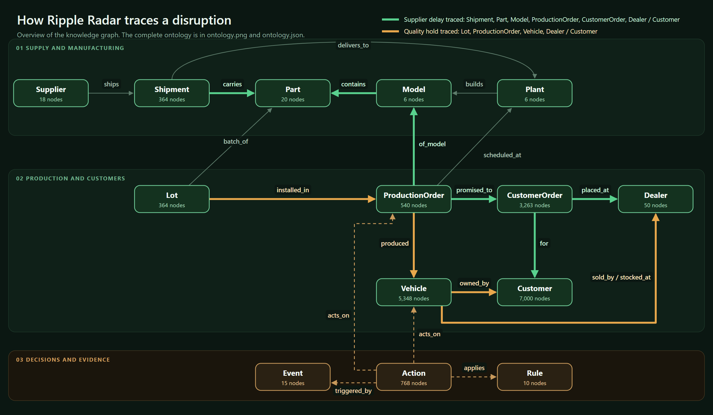

# Ripple Radar: Hack the Highway submission

Our team's submission for Hitachi's Hack the Highway challenge at TAMU Datathon 2026.

Ripple Radar is an operations control tower for Wacky Wheels Co. A small language model on the laptop reads each event message, and that is the only thing it does. Four agents then work out the impact by walking a knowledge graph of the company, plan the response under the policy handbook, check the plan, and send it to the enterprise server. Before planning, the relationships behind each reading (this shipment carries this part to this plant, which builds a model that uses it) are checked as edges in the graph. Every action is logged with the graph path that justifies it.

Source code: https://github.com/rajeshworimalla/tamu (folder `hitachi/`). Setup and reproduction: `hitachi/README.md`. Design documentation: `hitachi/DOCUMENTATION.md`. Code reference: `hitachi/CODE.md`.

The overview above shows the 14 node types, the main relationships and the two traversals the challenge tests most. Every edge drawn exists in the graph with the same direction. The complete ontology, all 27 relation types with counts, is `ontology/ontology.png` and `ontology/ontology.json`.

## Results on the 15 supplied events

| Check | Result |
|---|---|
| Events handled | 15: 10 real incidents (one compound), 2 escalated, 3 noise left alone |
| Enterprise calls | 768 sent, 768 accepted, 0 failed |
| Policy rules | All 10 handbook rules pass on every event (57 checks) |
| Graph fact check | 37 of 37 relationship checks on the resolved readings pass against the knowledge graph |
| Independent validator | Written separately, sharing no planner code; recomputes every expected action from its own annotated reading of each event, the handbook and the data: 0 missing, 0 extra, 0 wrong arguments |
| Reading check | The model's readings, resolved by code, match the validator's separate annotations on 15 of 15 events |
| Fresh replay | `run.py --execute` with no other flags (the model reads every event) on a new enterprise server: identical to `action_log.jsonl`, call for call |
| Model | Qwen2.5 3B, local. All 15 events read by the model on the first attempt, all matching the reference reading (`model_readings.json`). The official run used these model readings, not the reference |

These results are measured against our own validator and the enterprise simulator. They are not the hidden grader's score.

## Evidence for each test case

Every trace has a **Graph evidence** block per incident with the path the challenge asks for, a real example path, counts at each hop, and the fact check.

| Test case | Events | Required evidence | Example (from the traces) |
|---|---|---|---|
| Supplier delay | E-09, E-10, E-12 | Shipment > Part > Model (BOM) > ProductionOrder > CustomerOrder > Dealer / Customer | E-09: SH-0256 > CAM-360 > SUMMIT > PO-0436 > CO-02567 > D25 / C1467 |
| Plant outage | E-04, E-08, E-11 | Plant > ProductionOrder > CustomerOrder > Dealer / Customer, and the slot reasoning | E-11: P_MS > PO-0253 > CO-01460 > D02 / C5325; "Options considered" for each moved build |
| Quality hold | E-03, E-14, E-15 | Lot > ProductionOrder > Vehicle > Dealer / Customer | E-03: LOT-0130 > PO-0190 > AUR0002036 > D23 / C1865 (110 unsold, 150 sold) |
| Compound | E-01 | One graph path per incident | Outage P_TX and delay SH-0190, each with its own block |
| Noise | E-05, E-06, E-07 | Why it is not relevant | Code-written reason, no actions |
| Unconfirmed | E-02, E-13 | Why it is not actionable | One escalation, no operational change |

## Files

| Path | Contents |
|---|---|
| `action_log.jsonl` | The official action log written by the enterprise server (768 lines). Not edited. |
| `design_card.pdf` | One-page design card: architecture, LLM versus code, guardrails, evaluation, improvements |
| `DEVPOST.md` | The project write-up, with a map from each judging criterion to its evidence |
| `model_citation.md` | Model, version, runtime, license and role |
| `model_readings.json` | The model's raw reading of each of the 15 events: its JSON output, every attempt, timing, and the match against a hand-written reference (15/15) |
| `ontology/ontology_overview.png` | Simplified overview: 14 node types, the main relationships, the supplier-delay and quality-hold traversals highlighted |
| `ontology/ontology.png` | The complete ontology: all 27 relation types with counts, drawn from `ontology.json` |
| `ontology/ontology.json` | Graph schema: 14 node types and 27 relation types, with counts |
| `ontology/ontology.mmd` | The same schema as a Mermaid diagram; GitHub renders it, as does https://mermaid.live |
| `ontology/graph.json` | The full knowledge graph after the run: 17,772 nodes, 31,559 edges, node-link JSON, loads with `networkx.node_link_graph(data, edges="edges")` |
| `traces/E-01.json` to `E-15.json` | Machine-readable trace per event: message, classification, model attempts, resolved entities and dates, graph evidence and fact check, affected records, policy checks, every action with agent, rule, reason, graph path, options considered and server result |
| `traces/E-01.md` to `E-15.md` | The same traces, formatted for reading |
| `screenshots/` | 12 screens from the running app (below) |
| `evidence/` | `fresh_replay_action_log.jsonl` (the fresh model-driven replay's server log), `validator_comparison.json`, `readings_check.json`, `live_test_output.txt` (end-to-end live test, 14 of 14) |

The traces come from a fresh replay whose calls are identical to `action_log.jsonl`. Each trace's `result` field is the enterprise server's actual response.

## Screenshots

| File | Shows |
|---|---|
| `01-operations.png` | Operations: key figures, impact analysis, incidents needing review first |
| `02-incident-e09-impact-map.png` | E-09 supplier delay: the message read word by word, the ripple on the map |
| `03-incident-e09-graph.png` | E-09 graph traversal: source, part, models, builds, orders, people |
| `04-incident-e09-recovery-timeline.png` | E-09 recovery: each build before and after, transfers marked |
| `05-incident-e09-options-considered.png` | PO-0442: every option rejected and the slot chosen |
| `06-incident-e01-graph-evidence.png` | E-01 compound: one graph path per incident, every relationship check passed |
| `07-incident-e03-quality-hold.png` | E-03 quality hold: lot to vehicles, unsold and sold split |
| `08-incident-e13-rumor-escalated.png` | E-13 rumor: escalated, no records changed |
| `09-supply-network-po-0442.png` | Supply network: one record, its relations, and the actions taken on it |
| `10-evidence-action-log.png` | Evidence: execution summary, policy matrix, the full action log |
| `11-analytics.png` | Analytics: network impact, event timeline, disruption calendar |
| `12-validation-no-capacity-blocked.png` | Validation scenario: two plants down for the whole window; no compliant slot exists, so the plan is blocked and nothing is sent |

## Interpretation choices

The handbook leaves a few points open. We chose the reading below in each case and did not tune it to any expected answer.

| Point | Our reading | Effect if read differently |
|---|---|---|
| "next Friday", "next Tuesday" | The day in the following calendar week. E-01 item 2 only matches a real shipment this way, and E-03's "last Monday" matches its lot exactly | E-04 would affect a different set of builds |
| Transfer day | The earliest free slot at another plant on or after the disruption ends; earlier days only if none is left | Measured by rerunning the planner under the literal "any day" reading: exactly 5 of 768 calls differ, all `mes.transfer`, only in `new_date` (Mar 8 instead of Mar 31 or Apr 1) |
| Transfer plant on a tie | The order of `plants.csv` | 4 of 768 calls differ, only in `to_plant_id` |
| Loaners in a compound event | All affected customers of a dealer ranked together | 2 loaners in E-01 would change if ranked incident by incident |

Which orders are affected, every dealer notice, every loaner and every quality action are the same under all these readings. Only the transfer arguments above change. We kept one consistent reading rather than tuning to a guess about the grader: recovery starts when the disruption ends, at the same plant first.

## How the readings are kept honest

- The model reads every event in every production run. `run.py` and the app stop with a clear error if the model is unavailable.
- `tests/fixtures/reference_readings.json` is a hand-written reading used only to measure the model (`extract.py --check`) and for development (`run.py --reference`). It contains readings, not actions.
- `model_readings.json` holds the model's raw output for all 15 events, including its mistakes (in E-09 it named the trucking carrier as the supplier, which code ignored).

## Where to look first

1. `ontology/ontology.png`, then `traces/E-01.md`: the compound event, one graph path per incident.
2. `traces/E-09.md`: transfers, with the options considered for each build.
3. `traces/E-03.md`: a quality hold, lot to vehicles to owners.
4. `traces/E-13.md`: an unconfirmed rumor, escalated with no operational change.
